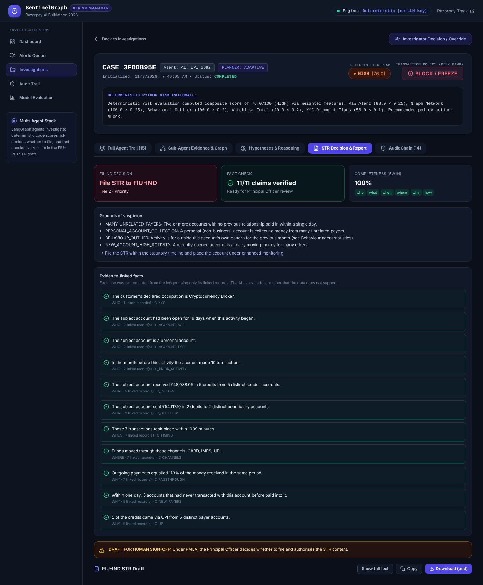
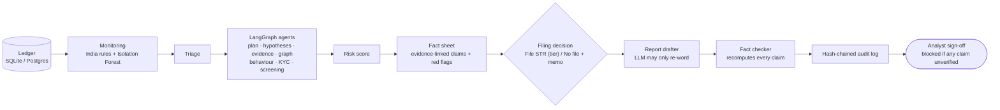
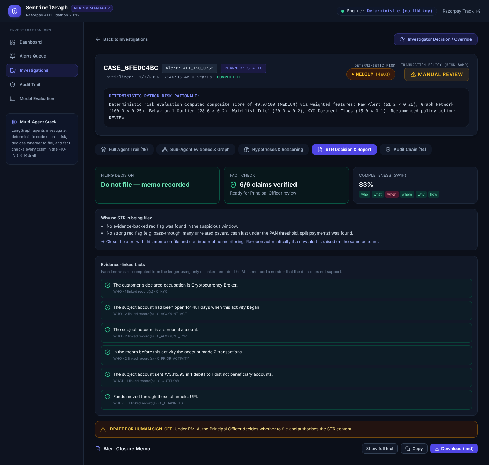
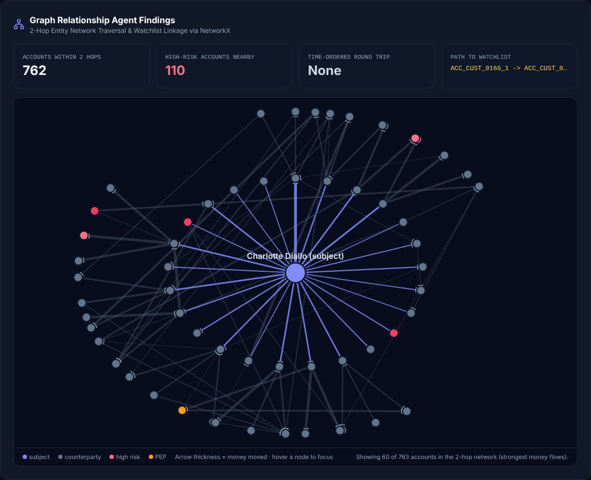
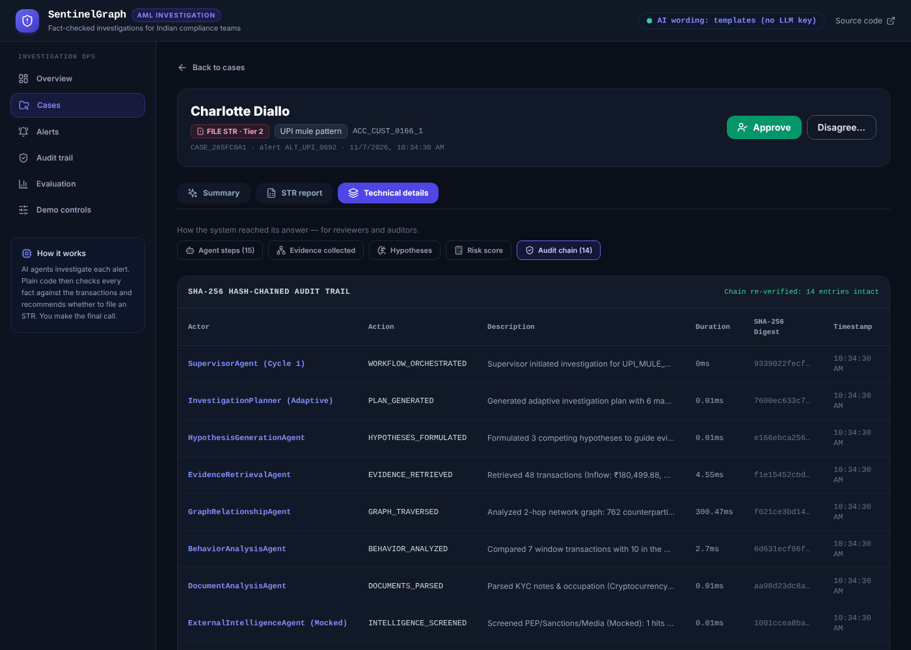

# 🛡️ SentinelGraph

**An India-first AML investigation assistant whose AI has to prove every claim it makes, and which decides whether a Suspicious Transaction Report is worth filing.**

[](https://github.com/hemashreems-1126/sentinelgraph-ai/actions/workflows/ci.yml)


Live demo: [sentinelgraph-frontend.onrender.com](https://sentinelgraph-frontend.onrender.com) · API docs: [/docs](https://sentinelgraph-backend-yeci.onrender.com/docs)
(free hosting — the first request can take ~1 minute while the server wakes up)



---

## The problem

Indian banks, payment aggregators, NBFCs and fintechs must investigate suspicious activity and file
**Suspicious Transaction Reports (STRs) with FIU-IND** under the PMLA. In practice:

- **Analysts drown in false alarms.** Industry estimates put 85–95% of transaction-monitoring alerts as false positives, with each alert taking 20–60 minutes to review ([Facctum](https://www.facctum.com/blog/aml-false-positive-report)).
- **Mule accounts are the backbone of UPI fraud.** RBI built [MuleHunter.AI](https://www.business-standard.com/amp/finance/news/what-is-mulehunter-ai-rbi-s-latest-tool-against-financial-fraud-explained-124120600865_1.html) to detect them, and mule networks were named the hardest fraud threat for Indian firms in 2026 ([India Fraud Report 2026](https://www.newkerala.com/news/a/mule-networks-biggest-fraud-threat-indian-firms-india-258.htm)).

**Who feels it:** compliance analysts and the PMLA *Principal Officer*, above all at small and
mid-sized Indian institutions, which have the same legal duties as big banks but not the budget.

### What already exists, and the gap

Agentic AML investigation tools already exist: Hawk's AML Investigative Agent, Unit21's agents, Lucinity's Luci copilot,
and Quantexa's entity-resolution graphs. They make investigations *faster*. SentinelGraph targets three things they leave open:

| Gap | Why it matters | What SentinelGraph does |
|---|---|---|
| **Nobody checks the AI's facts.** A hallucinated number in an STR is a regulatory problem, and vendor accuracy claims are self-reported. | Regulators expect explainable, validated outputs; US model-risk guidance (SR 26-2) even excludes agentic AI from its scope. | Every report sentence is an **evidence-linked claim**. A deterministic **fact checker** re-computes each one from the ledger and **blocks sign-off** if anything is unsupported. |
| **Tools help you file more, not better.** | FATF discourages *defensive filing* (low-quality "just-in-case" STRs) and has [suggested tiered STRs](https://sumsub.com/media/news/fatf-tiered-system-for-suspicious-transaction-reports/). | A **filing decision**: *File STR (Tier 1/2/3)* or *Don't file*, with a **documented closure memo**. |
| **Built for FinCEN, not FIU-IND.** | UPI mule chains and India's cash rules differ from US typologies. | **UPI mule-chain** and **₹50,000 PAN-threshold structuring** rules; an FIU-IND-style STR draft. |

**Where it sits:** SentinelGraph works *after* money has moved. It is not real-time payment blocking. It helps the analyst catch the
mule network quickly, freeze what is left, and protect the next victims.

---

## How it works



1. **Detection.** Rules for structuring just under the ₹50,000 PAN threshold, velocity, pass-through, 24-hour fan-in/fan-out and **UPI mule chains**, plus an Isolation Forest.
2. **Investigation.** LangGraph agents gather the ledger (ground-truth labels are hidden from them), map the money-flow network, detect **time-ordered round trips**, compare behaviour with the account's **own 45-day baseline**, read KYC and run (mock) PEP/sanctions screening.
3. **Fact sheet.** Ledger rows become claims such as *"The account received ₹78,801.61 in 6 credits from 6 distinct sender accounts"*. Each claim carries the IDs of its records and the assertions to check.
4. **Filing decision.** Filing needs corroborated red flags such as **first-time payers** (strangers, not regular customers), pass-through, split payments, onward layering, or a dormant/new account. A score alone is not enough. A "don't file" outcome is documented as carefully as a filing.
5. **Fact checker.** Recomputes every assertion from the cited records only, and rejects any number in the text that is not backed by an assertion, any record that does not exist, and any number in free text. It also scores 5W1H completeness. The analyst's `AGREE` is refused (HTTP 409) until the report is clean.
6. **Audit.** Every agent step and every analyst action goes into a **SHA-256 hash chain**. Editing, deleting or reordering any entry is detected by `GET /api/audit/verify/{case_id}`.

The **LLM is optional** (Groq / LLaMA-3.3). Without a key, every step uses deterministic logic. With a key, the LLM can re-word
claims and the narrative, but it never decides a number, a score, a filing decision or a fact.

| Fact-checked STR (UPI mule) | Documented "don't file" memo |
|---|---|
|  |  |

| Money-flow network | Hash-chained audit trail |
|---|---|
|  |  |

---

## Results (honest evaluation)

Every number comes from **actually running** detection, the agents, the filing decision and the fact checker on
**held-out alerts** (`python run_eval.py --cases 200`, seed 42, full output in [`backend/evaluation_results.json`](backend/evaluation_results.json)).

**Ground truth:** an alert is truly suspicious if its subject account is controlled by the synthetic criminal network.
Victims, smurfs/feeders and **legitimate look-alikes** (kirana shops collecting UPI payments, payroll runs, monthly rent splits, cash businesses) are
negatives, so that no rule can look perfect.

| Stage | Metric | Result |
|---|---|---|
| **Detection** (351 alerts) | Alert precision · criminal accounts alerted | **79.2%** · **87.6%** of 499 |
| **Filing decision** (196 investigated) | Precision / Recall / F1 | **86.6% / 73.6% / 0.795** |
| | Alerts closed with a written reason (workload removed) | **39.3%** |
| | Legitimate look-alikes wrongly filed | 30.8% of 52 |
| | ROC-AUC of the weighted risk score alone | 0.56 *(weak; the evidence-based decision does the work)* |
| **Fact checking** | Genuine reports fully verified · claims grounded · 5W1H completeness | **100% · 100% · 99.6%** |
| | Deliberately corrupted reports caught (980 tests, 5 corruption types) | **99.9%** |

<details><summary>Per-alert-type breakdown</summary>

| Alert type | Alerts | Detection precision | Investigated | Filed | Truly suspicious | Filing correct |
|---|---|---|---|---|---|---|
| Structuring (PAN threshold) | 22 | 95% | 22 | 22 | 21 | 95% |
| Mule account | 65 | 91% | 27 | 18 | 21 | 89% |
| Layering | 37 | 100% | 25 | 20 | 25 | 80% |
| Fan-in aggregation | 60 | 72% | 36 | 24 | 19 | 81% |
| UPI mule chain | 20 | 60% | 20 | 17 | 12 | 75% |
| Velocity abuse | 17 | 65% | 17 | 4 | 11 | 59% |
| Fan-out dispersion | 15 | 53% | 15 | 0 | 8 | 47% |
| Isolation Forest | 115 | 76% | 34 | 14 | 23 | 50% |

The five corruption types are: a number added to a sentence, an inflated value, a fabricated record ID, a claim with no evidence, and a number in free text.
</details>

**Evaluate on data the system did not generate:** download the
[IBM AML dataset](https://www.kaggle.com/datasets/ealtman2019/ibm-transactions-for-anti-money-laundering-aml) (e.g. `HI-Small_Trans.csv`) and run

```bash
cd backend
python run_eval.py --ibm path/to/HI-Small_Trans.csv --max-rows 200000 --cases 200
```

---

## Run it

**One click:** `./start.sh` (macOS/Linux) or `start.bat` (Windows). This installs dependencies on first run, starts the API on `:8000`
and the UI on `:3000`, and seeds a demo dataset with six investigated cases and an evaluation.

**Manually**

```bash
cd backend && pip install -r requirements.txt && uvicorn app.main:app --reload    # http://localhost:8000/docs
cd frontend && npm install && npm run dev                                         # http://localhost:3000
```

**Docker (PostgreSQL)**

```bash
cp .env.example .env          # set POSTGRES_PASSWORD (no default on purpose)
docker compose up --build     # UI http://localhost:3000 · API http://localhost:8000/docs
```

**Optional LLM:** set `GROQ_API_KEY` in `.env`. Everything works without it.

**Tests:** `cd backend && python -m pytest tests -q`. There are 31 tests: the fact checker catching hallucinations, the filing policy,
the approval gate, audit-chain tamper detection, the external-dataset loader and the end-to-end pipeline. CI runs them on **SQLite and PostgreSQL**,
runs an evaluation and builds the frontend.

### Database

- SQLite locally and PostgreSQL in Docker, through the same code. Point `DATABASE_URL` at any Postgres (e.g. free Neon or Render Postgres) for persistence.
- **Alembic migrations** run automatically on startup. Databases from the first release are detected and upgraded in place.
- Indexed for the main query pattern: an account's transactions in a time window.
- On Render's free tier SQLite is reset on every redeploy (the demo re-seeds itself). Use Postgres for anything persistent.

---

## API highlights

| Endpoint | Purpose |
|---|---|
| `POST /api/investigations/start` | Run the full multi-agent investigation for an alert |
| `GET /api/investigations/{id}` | Case with filing decision, fact-checked report, agent trail |
| `POST /api/investigations/{id}/feedback` | Analyst AGREE / DISAGREE / OVERRIDE (`AGREE` → 409 if claims unverified) |
| `GET /api/audit/verify/{case_id}` | Re-verify the case's SHA-256 hash chain |
| `POST /api/evaluation/run` | Staged evaluation on held-out alerts |
| `POST /api/alerts/generate` | Replace the dataset (requires `confirm_reset: true`) |

## Project structure

```
backend/
  app/agents/          LangGraph workflow, sub-agents, fact_sheet, filing_decision, report_drafter, fact_checker, auditing
  app/services/        data_generator (India-first + look-alikes), monitor, external_data (IBM), round_trip, graph_store, llm
  app/utils/           evaluation_runner (staged, honest evaluation)
  alembic/             database migrations
  scripts/             export_offline_snapshot.py (read-only UI data from a real run)
  tests/               31 tests
  run_eval.py          evaluation CLI (synthetic or IBM dataset)
frontend/src/          React + TypeScript UI (dashboard, alerts, investigations, STR viewer, audit, evaluation)
docs/                  pipeline_spec.md, screenshots
.github/workflows/     CI (SQLite + PostgreSQL tests, evaluation run, frontend build)
```

---

## Limitations (stated plainly)

- **Synthetic data.** Labels come from our own generator, look-alikes included. The IBM loader exists to test on external data, but its results have not yet been published here.
- **Thresholds are hand-set from typologies,** not learned. The weighted risk score separates poorly on its own (ROC-AUC 0.56) and is only used for tiering.
- **Weak spots in the numbers above:** fan-out dispersal looks like payroll (0 of 8 filed); about 31% of legitimate look-alikes are still filed.
- **PEP/sanctions screening is mocked.** There is no real watchlist feed.
- **Single-institution view.** Mule networks span banks; cross-bank sharing (as in RBI's DPIP / MuleHunter) is out of scope.
- **Not real-time.** It does not stop the first fraudulent payment. It speeds up the investigation afterwards.
- **Not legal advice.** Draft STRs need Principal Officer review, which the app enforces.

## What changed in v2

The first version reported "100% recall / ROC-AUC 0.99", but its evaluator sampled scores *from the ground-truth labels*, and its behaviour agent returned
fixed z-scores per alert type. v2 replaced both with real computation and added the fact checker, the filing decision, India-specific rules,
legitimate look-alikes, a hash-chained audit log, Alembic migrations and PostgreSQL support. It also stopped the UI from silently showing mock data or faking a successful sign-off.

## License

MIT. Built for the Razorpay AI Buildathon 2026 (AI Risk Manager track). All data is synthetic; any resemblance to real people is coincidental.
